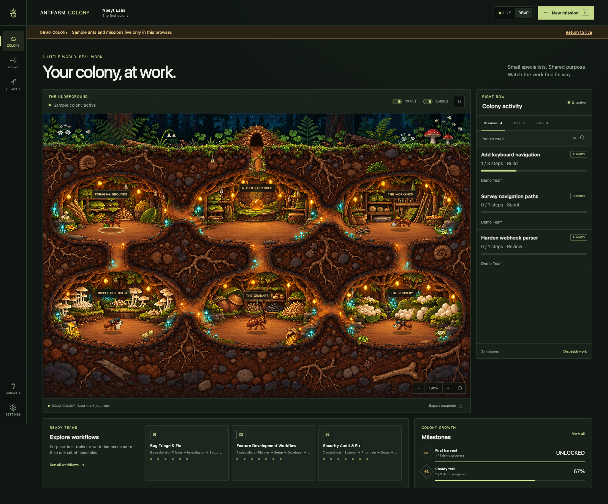

# Antfarm Colony

A living pixel ant colony for real agent workflows. Scouts investigate, builders implement, verifiers inspect, and successful handoffs leave fading trails through the underground.



This is a **new, independent project** for NosytLabs. Agent Office remains unchanged. The workflow foundation is the MIT-licensed [snarktank/antfarm](https://github.com/snarktank/antfarm); the colony interface and artwork are new.

## Start a colony

Requires **Node.js 24 or newer** and npm.

```sh
git clone https://github.com/NosytLabs/antfarm-colony.git
cd antfarm-colony
npm ci
npm run setup
npm start
```

Open **http://127.0.0.1:8114**. Choose **Start repository survey** for a real local inventory, quality report, and summary. No model credentials are needed. The survey reads the configured directory and does not edit it or execute its code.

Surveys skip dependency, version-control, common build/cache and virtual-environment directories, sensitive filenames, and symlinks. Reports include skipped-directory counts so compiled copies do not inflate source findings.

```sh
ANTFARM_WORKSPACE=/absolute/path/to/project npm start
```

Set `ANTFARM_HOME` to override colony state storage. Set `PORT` to change the dashboard port. Keep the dashboard local; see [security boundaries](SECURITY.md).

Setup saves the workspace and port. Use `npm run setup -- --check` for diagnostics. For a non-interactive start, use `npm run build` instead of setup and provide `ANTFARM_WORKSPACE` if needed.

## What lives here

- Six connected chambers, four ant roles with 32 walking/working frames, 24 props and structures, and original forest cutaway artwork.
- Missions grouped by run with live step output, acceptance criteria, stories, retries, dependency handoffs, and a side inspector that stays open as work progresses.
- A credential-free repository survey; OpenCode, Hermes, or custom CLI single-worker and plan/build/verify teams; and the full upstream OpenClaw feature-development, bug-fix and security-audit workflows.
- Separate **Live** and **Demo** modes. Demo missions run only in browser memory and are labeled throughout.
- Seven growth milestones derived from task history; completed work adds colony decorations.
- Three themes, labels and trail toggles, reduced motion, animation pause, zoom/pan, keyboard controls, and JSON snapshot export.
- Desktop and mobile layouts with DOM controls for inspecting work without using the canvas.
- Guided first-run setup, a pinned Antseed CLI connector, model discovery, and an optional OpenCode activity plugin.

This visualizes durable workflow state. Fading trails show completed handoffs; they are not an ACO scheduler or proof of a fully decentralized swarm.

## Connect real AI workers

**OpenCode or Hermes:** configure the CLI and its model/provider first, then restart Colony. In **New mission**, choose **CLI specialist** or **Plan → build → verify**, select the detected runtime, and describe the outcome. Each step starts a fresh process in `ANTFARM_WORKSPACE`. The panel shows public output and tool status as they arrive. Cancellation stops the process; a failed run can resume from its unfinished step. Completed results are preserved. Verification requires an explicit `VERDICT: PASS`.

**Any other noninteractive CLI:** configure an argument array on the server. The prompt is passed literally without a shell:

```sh
ANTFARM_HARNESS_COMMAND='["your-cli","--prompt","{prompt}"]' npm start
```

Choose **Custom CLI** at dispatch. Use the command and flags your harness supports. Tools retain their own models, permissions and costs. CLI role instructions are guidance; tool access restrictions come from the runtime. One CLI mission runs at a time per dashboard process to avoid concurrent edits in its workspace. Steps have a 30-minute timeout; the last 64 KiB of public output is retained per step and the latest 12 KiB is available for handoffs. An interrupted run requires explicit resume after restart. [Runtime guide](docs/integrations.md).

**OpenClaw:** the original YAML workflow engine remains available:

Configure [OpenClaw](https://docs.openclaw.ai/) separately, including provider credentials and tools. Then explicitly install a bundled workflow:

```sh
npm run cli -- workflow list
npm run cli -- workflow install feature-dev
npm run cli -- workflow run feature-dev "Implement a feature in /absolute/path/to/repo with acceptance criteria"
```

Installation modifies the selected OpenClaw configuration and provisions worker workspaces. Review the workflow first. Workflows may edit the target repository and create pull requests; use a working branch and appropriate tool permissions. The UI enables dispatch when the runtime and selected workflow are available.

`OPENCLAW_STATE_DIR` and `OPENCLAW_CONFIG_PATH` select OpenClaw state/configuration. See [integrations](docs/integrations.md), [Antseed research](docs/antseed.md), and [workflow authoring](docs/upstream/creating-workflows.md).

## Antseed model supply

After building Colony:

```sh
npm run antseed -- install
npm run antseed -- setup
npm run antseed -- start
```

Keep the buyer terminal open. In another terminal, use `npm run antseed -- models` or **Connect → Check local proxy & models**. Then print an OpenClaw provider entry:

```sh
npm run antseed -- config --model YOUR_DISCOVERED_MODEL_ID
```

Merge the printed entry into OpenClaw, preserving existing settings, select `antseed/YOUR_DISCOVERED_MODEL_ID` with `openclaw models set`, restart the gateway, and install a workflow. Verify the model's tool support and context limits first.

The connector installs **@antseed/cli 0.1.168** in isolated colony state, uses zero input/output/cached token price caps, refuses an occupied proxy port, and never automatically funds a wallet. Antseed does **not** guarantee free models: sellers control availability, quotas and prices. A zero-token offer in the catalog is discovery metadata, not a successful inference check. Local Ollama is another option without per-token provider fees; it needs suitable hardware. See the [complete Antseed guide](docs/antseed.md).

For sessions you start outside Colony, the optional [OpenCode telemetry plugin](integrations/opencode/README.md) reports status. Other runtimes can use the same metadata event API with their own source name. Observed sessions stay controlled in their original CLI; missions dispatched by Colony have local start/cancel/resume controls.

## Controls

| Control | Action |
| --- | --- |
| Click an ant, chamber label, or roster item | Inspect work |
| `N` | New mission |
| Space, outside interactive controls | Pause or resume animation |
| `+` / `−` buttons | Zoom; drag the scene while zoomed |
| Escape | Close an open dialog |
| Settings | Theme, labels, trails, reduced motion |

Animation pause does not stop workflows. Cancel a mission from its inspector when needed.

## Development and checks

```sh
npm test
npx playwright install chromium
npm run test:browser
```

The browser check starts an isolated server. Optionally set `PLAYWRIGHT_CHROMIUM_EXECUTABLE` to an existing compatible Chromium binary. Tests use temporary state rather than your real OpenClaw installation.

Source map: `src/` engine and HTTP server; `web/` interface and renderer; `workflows/` YAML teams; `tests/` regression tests; `scripts/` local server and verification. [Architecture](docs/design.md) explains boundaries, [research](docs/research.md) compares references, and [validation](docs/validation.md) records tested behavior and integration limits.

## Credits and license

MIT, with upstream copyright retained in [LICENSE.upstream](LICENSE.upstream). See [provenance](docs/UPSTREAM.md). Generated artwork is documented in [web/assets/README.md](web/assets/README.md). Geist Pixel uses the [SIL Open Font License](web/fonts/OFL.txt). No office artwork from reference projects is bundled.
